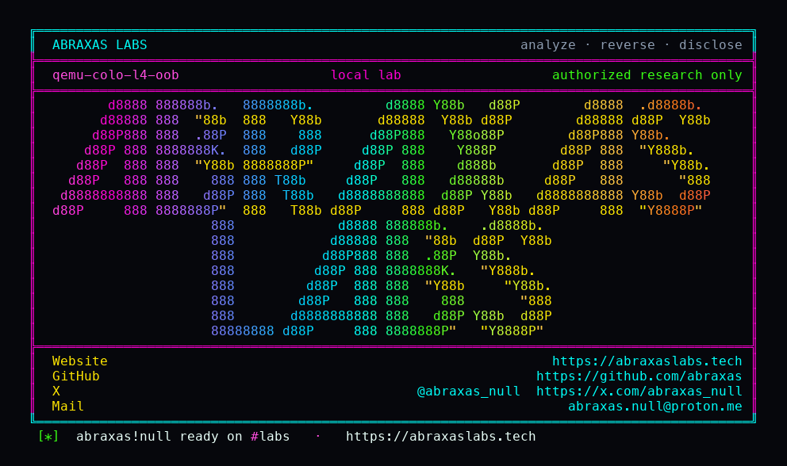

<p align="center">
  
</p>

<p align="center">
  <a href="https://abraxaslabs.tech"><strong>abraxaslabs.tech</strong></a>
  &nbsp;·&nbsp;
  <a href="https://github.com/abraxas">github.com/abraxas</a>
  &nbsp;·&nbsp;
  <a href="https://x.com/abraxas_null">@abraxas_null</a>
  &nbsp;·&nbsp;
  <a href="mailto:abraxas.null@proton.me">abraxas.null@proton.me</a>
  &nbsp;·&nbsp;
  <a href="https://github.com/abraxas/qemu-colo-l4-oob">qemu-colo-l4-oob</a>
</p>

# qemu-colo-l4-oob

**QEMU** `v11.1.2` (`4fc49f46dc95d4a27de2509e7fceb2931e91faeb`) - COLO filter-rewriter

**Class:** OOB (heap buffer overflow READ/WRITE). **Reach:** Local (guest) / Remote (COLO peer).

[`parse_packet_early`](https://github.com/qemu/QEMU/blob/v11.1.2/net/colo.c) accepts IPv4 once L2 plus `ip_hl*4` fits. It never requires a minimum L4 header. `fill_connection_key` then reads four bytes at `transport_header` with no remaining-length check. `filter-rewriter` copies the frame with `g_malloc0(size)` and, after SYN has moved the connection to `TCPS_SYN_RECEIVED`, an ACK with `conn->offset != 0` writes `th_ack` / `th_seq` past that chunk when the captured length ends at the transport header.

COLO is not default. It is on when `-object filter-rewriter` (and colo-compare) is configured. Guest TX/RX on that rewriter is in the virtualization security model. A COLO peer on `primary_in` / `secondary_in` is a network protocol, also untrusted.

**A 34-byte IPv4/TCP frame is enough for ASan heap-buffer-overflow READ in filter-rewriter.**

| | |
|---|---|
| ID | no CVE yet |
| CWE | [CWE-125](https://cwe.mitre.org/data/definitions/125.html) / [CWE-787](https://cwe.mitre.org/data/definitions/787.html) |
| CVSS | **High: 8.2** `CVSS:3.1/AV:L/AC:L/PR:H/UI:N/S:C/C:H/I:H/A:H` |
| Product | [QEMU](https://github.com/qemu/QEMU) |
| Affected | **v11.1.2** (`4fc49f46`), COLO rewriter/compare enabled |
| Auth | guest on a COLO rewriter netdev, or a COLO compare peer |
| License | [GNU Affero GPL v3.0](LICENSE) |
| Lab | `127.0.0.1:18770` / `18771` loopback sockets |

## What an attacker can do

Who: untrusted guest on a COLO-enabled NIC, or a hostile COLO compare peer. Guest-to-host / peer-to-host. QEMU userspace heap.

### Integrity / recon (lab-proven)

| Method | Sink | Privilege |
|---|---|---|
| Short IPv4/TCP ACK after a full-header SYN (34-byte frame, length ends at transport header) | `filter-rewriter` `handle_primary_tcp_pkt` / `fill_connection_key` | **ASan heap-buffer-overflow READ** in filter-rewriter. Control full-header TCP leaves QEMU alive. |
| Same missing L4 floor | `parse_packet_early` `net/colo.c:43-98` | Packet is classified as TCP without an L4 header in-buffer. |

### Integrity (inferred, same missing bound)

After SYN, `conn->offset != 0`, rewriter stores `th_ack` / `th_seq` at `net/filter-rewriter.c:112-114` and `:216-218`. IP options (`ip_hl > 5`) shift that write onto the next heap chunk. Guest-triggerable host heap WRITE.

colo-compare `fill_pkt_tcp_info` sets `header_size` from `th_off<<2` with no check against `pkt->size`. `payload_size` underflows. `colo_compare_packet_payload` `memcmp`s tens of kilobytes past both packet allocations. Crash plus host heap READ.

### Availability (lab-proven)

QEMU abort under ASan on the rewriter READ. Without ASan this is a live heap OOB in the hypervisor process.

### Adjacent surface that stays closed

- TAP / socket / bridge / l2tpv3 / stream / dgram length paths on this pin looked bounded (`net_fill_rstate` rejects `packet_len > NET_BUFSIZE`).
- Unbounded COLO connection-table leak on hashtable reset is alloc hardening, not this leftover.
- Kernel PwnEscape / Vghost: out of QEMU.
- Default QEMU without COLO: rewriter is not on. This leftover needs COLO configured.

The lab does not demonstrate RIP control or a guest-to-host shell. The class is heap OOB of the QEMU process on a COLO-enabled netdev.

## How I found it

I read `net/colo.c` looking for a length floor that included L4. The floor is Ethernet plus VLAN plus vnet_hdr. `ip_hl` is taken from a short tail. `fill_connection_key` then trusts `transport_header`. filter-rewriter always loads `th_flags` at offset 13 of `struct tcp_hdr`.

Wrong turns: treating TAP length as the COLO bound (different path); sending the overflow as the first packet (rewriter needs SYN first so `conn->offset` is live); colo-compare `th_off` underflow as the primary witness (rewriter READ fired first).

## Lab

```bash
cd lab
./run.sh
```

Target **only** loopback sockets `127.0.0.1:18770` (filter-rewriter netdev) and `18771` (colo-compare). Pin is cloned from github.com/qemu/QEMU tag `v11.1.2` / `4fc49f46`. ASan. COLO proxy enabled at configure time. Witness-only.

```text
SUCCESS qemu-colo-l4-oob asan=heap-buffer-overflow access=READ sink=filter-rewriter control=alive QEMU-COLO-L4-OOB-WITNESS
```

Replay: `python3 qemu-colo-l4-oob-Abraxas-Labs.py`.

## The fix

`parse_packet_early` must require a full L4 header (TCP 20, UDP 8, SCTP 12, AH 8) after the IP header, and reject when `size` ends at or before `transport_header`. `fill_connection_key` and the rewriter `th_*` stores must check remaining length. colo-compare must reject `th_off<<2` that does not fit in `pkt->size` before computing `payload_size`.

## References

- [github.com/qemu/QEMU](https://github.com/qemu/QEMU) tag [v11.1.2](https://github.com/qemu/QEMU/releases/tag/v11.1.2) commit `4fc49f46dc95d4a27de2509e7fceb2931e91faeb`
- [`parse_packet_early`](https://github.com/qemu/QEMU/blob/v11.1.2/net/colo.c) · [`filter-rewriter`](https://github.com/qemu/QEMU/blob/v11.1.2/net/filter-rewriter.c)
- Same pin: [qemu-xhci-complete-uaf](https://github.com/abraxas/qemu-xhci-complete-uaf) · [qemu-nvme-sgl-bar](https://github.com/abraxas/qemu-nvme-sgl-bar)
- Series: [QEMU 11.1.2 leftovers](https://abraxaslabs.tech/research/qemu-11.1.2-leftovers)
- [CWE-125](https://cwe.mitre.org/data/definitions/125.html) · [CWE-787](https://cwe.mitre.org/data/definitions/787.html)

## License

GNU Affero GPL v3.0. See [LICENSE](LICENSE). Loopback lab only. No warranty.
